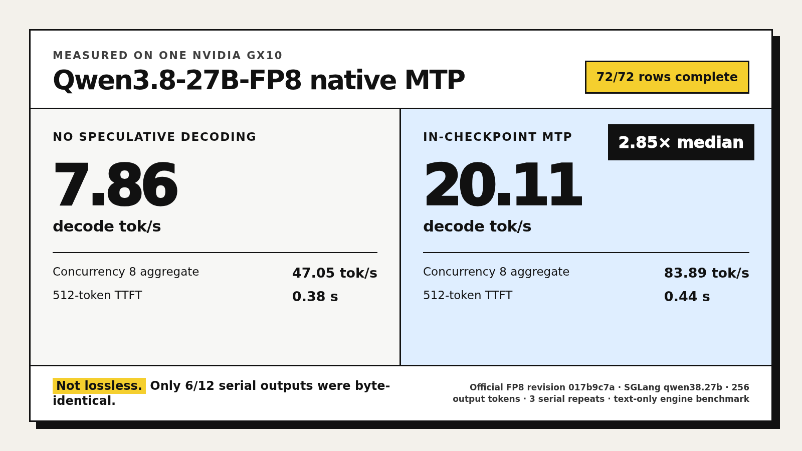

# Qwen3.8-27B-FP8 on one NVIDIA GX10

A tested single-GX10 recipe for the official [`Qwen/Qwen3.8-27B-FP8`](https://huggingface.co/Qwen/Qwen3.8-27B-FP8) checkpoint using SGLang, with native in-checkpoint MTP, startup memory guards, and complete benchmark receipts.



## Measured result

One NVIDIA GB10, 128 GB unified memory. Three serial repetitions per context target, eight requests per concurrency cell, and exactly 256 generated tokens per measured request.

| Input tokens | No-spec TTFT | No-spec decode | MTP TTFT | MTP decode |
|---:|---:|---:|---:|---:|
| 512 | 0.38 s | 7.86 tok/s | 0.44 s | **20.11 tok/s** |
| 4,096 | 2.85 s | 7.80 tok/s | 2.88 s | **21.78 tok/s** |
| 16,384 | 19.56 s | 7.50 tok/s | 19.09 s | **21.93 tok/s** |
| 32,768 | 41.59 s | 7.18 tok/s | 41.20 s | **20.87 tok/s** |

At concurrency 8:

| Mode | Aggregate completion throughput | Median TTFT |
|---|---:|---:|
| No-spec | 47.05 tok/s | 8.79 s |
| Native MTP | **83.89 tok/s** | 8.79 s |

Across all 12 paired serial rows, MTP delivered a **2.85x median decode ratio** and a **1.92x median end-to-end ratio**.

### MTP is not lossless here

Only **6/12 serial outputs** and **17/24 concurrency outputs** were byte-identical across the matched arms. This benchmark establishes a throughput result, not equivalent task quality. Validate MTP on the workload you intend to serve.

## Exact stack

| Component | Frozen value |
|---|---|
| Hardware | NVIDIA GB10, SM121, 128 GB unified memory |
| Model | `Qwen/Qwen3.8-27B-FP8` |
| Model revision | `017b9c7af6b5689d5dd426a76e0bc077eb5ca20a` |
| Model snapshot | 81 files, 30,890,049,597 bytes |
| Container | `lmsysorg/sglang@sha256:febfb971c7352570fc445c466ebd6ffc9d896024958e544a60f2137fd85856b1` |
| SGLang | `0.0.0.dev0+qwen38.27b.g561c8f3` |
| PyTorch | `2.13.0+cu130` |
| Transformers | `5.12.1` |
| CUDA | `13.0` |
| Attention | Configured full-attention backend: FlashInfer; hybrid GDN kernels: Triton |
| Static-memory fraction | `0.70` |

The public helper scripts require only Python's standard library, Bash, Docker, curl, and the NVIDIA runtime.

## Requirements

- NVIDIA DGX Spark or another GB10 system running Linux on `aarch64`
- 128 GB unified memory
- Docker with NVIDIA Container Toolkit
- Python 3.10 or newer
- `curl` and `nvidia-smi`
- Approximately 90 GB free before the first model and image download

The container image is approximately 38.6 GB. The verified model snapshot is approximately 30.9 GB.

## Quick start

```bash
git clone https://github.com/sxuff/qwen38-27b-fp8-gx10.git
cd qwen38-27b-fp8-gx10

python3 scripts/download.py
./scripts/serve.sh
python3 scripts/smoke_test.py
```

The downloader is pinned to the measured model revision, resumes partial files, verifies every Hugging Face LFS object against official SHA-256 metadata, verifies every non-LFS file against its Git blob identity, and preserves 20 GiB of free disk by default. Before every launch, the recipe also hashes all 81 files against the measured snapshot report.

If the model already exists elsewhere:

```bash
MODEL_DIR=/path/to/snapshot ./scripts/serve.sh
```

Startup takes roughly 7 to 8 minutes on the measured GX10 because the runtime loads the weights and captures CUDA graphs.

The safe public default binds the API to `127.0.0.1`. To expose it on the network, set `HOST=0.0.0.0` and add your own firewall and authentication layer:

```bash
HOST=0.0.0.0 ./scripts/serve.sh
```

Do not expose the unauthenticated OpenAI-compatible endpoint directly to the public internet.

Stop the owned container with:

```bash
./scripts/stop.sh
```

## Serving modes

### No speculative decoding

```bash
./scripts/serve.sh
```

This is the default because MTP did not preserve every deterministic output.

### Native MTP, explicit opt-in

Only **6/12 serial outputs** and **17/24 concurrency outputs** were byte-identical in the matched benchmark. Validate task quality before using this mode:

```bash
MODE=mtp ./scripts/serve.sh
```

MTP adds only:

```text
--speculative-algorithm EAGLE
--speculative-num-steps 3
--speculative-eagle-topk 1
--speculative-num-draft-tokens 4
```

The runtime loaded `Qwen3_5ForCausalLMMTP`. Across 47 periodic decode-log snapshots, median acceptance was 0.96 and median accepted length was 3.88 of 4. These are periodic log samples, not exact aggregate acceptance counters.

## Reproduce the benchmark

Run each arm from a fresh model load:

```bash
MODE=no-spec ./scripts/serve.sh
MODE=no-spec OUTPUT="$PWD/runs/repro/results/no-spec" ./scripts/run_benchmark.sh
./scripts/stop.sh

MODE=mtp ./scripts/serve.sh
MODE=mtp OUTPUT="$PWD/runs/repro/results/mtp" ./scripts/run_benchmark.sh
./scripts/stop.sh

python3 scripts/analyze.py runs/repro
```

A reproduction run captures exact prompt and completion counts, TTFT, end-to-end latency, reconstructed decode throughput, request and response hashes, raw SSE, concurrency wall time, memory, swap, GPU utilization, temperature, and power. The wrapper requires the running container's mode, labels, image, launch flags, and byte-verified model identity to match its launch manifest.

For a fast harness check before the full matrix:

```bash
MODE=no-spec \
SERIAL_INPUTS="512" \
CONCURRENCY_LEVELS="1" \
OUTPUT_TOKENS=16 \
REPETITIONS=1 \
REQUESTS_PER_CONCURRENCY=1 \
OUTPUT="$PWD/runs/quick/results/no-spec" \
./scripts/run_benchmark.sh
```

The published metrics always use the frozen full matrix, not this reduced check.

## Memory guard

The startup and benchmark wrappers stop only the recipe-owned container when either condition is crossed:

- `MemAvailable < 15 GiB`
- swap growth exceeds 512 MiB from the arm baseline

A pre-readiness attempt at `--mem-fraction-static 0.75` crossed the sealed swap-growth guard by 26,406,912 bytes during CUDA-graph capture. It produced no primary benchmark trace. Both measured arms used `0.70` and completed without a safety incident.

This is one-host evidence. It does not prove that 0.75 or the cookbook's 0.95 setting fails on every DGX Spark. Treat the memory fraction as an operating point and monitor host headroom during startup.

## Evidence map

- [`PROTOCOL.md`](PROTOCOL.md): frozen benchmark contract
- [`AMENDMENTS.md`](AMENDMENTS.md): pre-primary memory amendment
- [`preregistration.json`](preregistration.json): frozen revisions, hashes, matrix, and safety guards
- [`runtime-manifest.json`](runtime-manifest.json): image and package versions
- [`results/summary.json`](results/summary.json): denominator-complete aggregate results
- [`results/no-spec`](results/no-spec) and [`results/mtp`](results/mtp): curated row-level receipts and source identities
- [`results/telemetry-summary.json`](results/telemetry-summary.json): aggregate host and GPU telemetry
- [`results/private-archive-manifest.json`](results/private-archive-manifest.json): SHA-256 commitment to the omitted raw archive
- [`results/posthoc-diagnostics.json`](results/posthoc-diagnostics.json): explicitly labeled post-hoc calculations
- [`environment/source-archive-final-verification.json`](environment/source-archive-final-verification.json): original private-archive verification
- [`environment`](environment): model manifest and complete model verification report
- [`REPORT.md`](REPORT.md): compact generated report

Verify the public surface locally:

```bash
./scripts/ci.sh
```

Expected:

```text
PUBLICATION_VERIFY_OK: 72/72 curated rows, matched requests, regenerated aggregates, private-archive commitment, frozen hashes, privacy allowlist, 1600x900 card
REPOSITORY_CHECKS_OK
```

The files in `src/` are the exact benchmark and telemetry programs hashed before primary collection. The hardened public programs in `scripts/` add fail-closed row validation, mode and image binding, exact model verification, ownership labels, and watchdog supervision.

## Scope

This is a text-serving engine benchmark. It does not measure model quality, video understanding, BF16, GGUF, NVFP4, other GPUs, or other serving engines.

The scripts in this repository use the MIT License. The Qwen checkpoint and SGLang container retain their respective upstream licenses.
